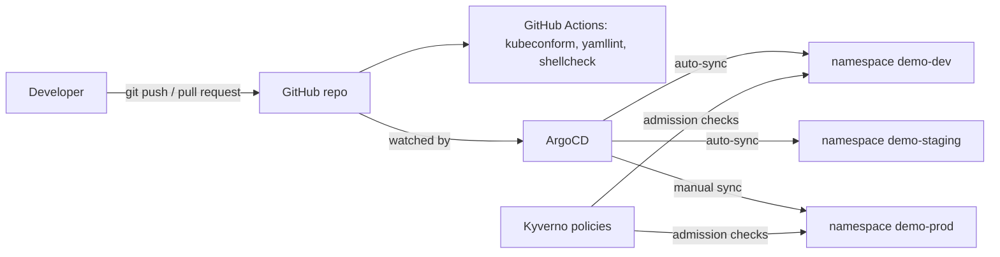

<h1 align="center">☸️ Cloud-Native GitOps Platform</h1>
<p align="center">Kustomize overlays, ArgoCD and Kyverno, with every manifest validated in CI</p>

<p align="center">
  
  
  
  
  
  
</p>

---

## 🎯 What it is

A GitOps repository for a small web service. **Git is the single source of truth.** A change goes through a pull request, CI renders and validates every environment, and ArgoCD makes the cluster match Git.

## 📊 Status

| Area | Status | Evidence |
|---|---|---|
| Kustomize base and dev, staging, prod overlays | ✅ Done | `kubectl kustomize overlays/dev` renders |
| Schema validation of every overlay | ✅ Done | `validate` workflow runs kubeconform |
| YAML and shell linting | ✅ Done | `yamllint` and `shellcheck` workflows |
| Dev overlay on a local kind cluster | ✅ Verified locally | Pods Ready, page served through port-forward |
| ArgoCD syncing a live cluster | ⏳ Planned | `argocd/*.yaml` written, not installed yet |
| Kyverno policies enforced in a cluster | ⏳ Planned | Policies written, not installed yet |

## 🏗️ Architecture



## 🔁 How a change reaches production

1. Open a pull request that edits `base/` or an overlay.
2. CI renders dev, staging and prod, then validates each one with kubeconform.
3. Merge to `main`.
4. ArgoCD auto-syncs dev and staging.
5. Prod waits for a human to click **Sync**. This is on purpose.


## 📄 File guide

| File | What it does | Connected to |
|---|---|---|
| `base/kustomization.yaml` | Lists the shared resources | Every overlay builds from it |
| `base/deployment.yaml` | Runs the web pods with probes, limits and non-root security | Service, HPA, PDB, ConfigMap |
| `base/service.yaml` | Gives the pods one stable address on port 80 | Pods labelled `app: web` |
| `base/configmap.yaml` | Non-secret settings such as `LOG_LEVEL` | Injected into the Deployment |
| `base/hpa.yaml` | Scales pods on CPU usage | Targets the Deployment |
| `base/pdb.yaml` | Keeps at least one pod running during node maintenance | Pods labelled `app: web` |
| `base/networkpolicy.yaml` | Allows ingress only on port 8080 | Pods labelled `app: web` |
| `base/ingress.yaml` | Routes `web.example.com` to the Service | Service `web`, port 80 |
| `base/serviceaccount.yaml` | Pod identity with no auto-mounted API token | Available, see known gaps |
| `overlays/*/kustomization.yaml` | Changes only what differs per environment | Builds from `base/` |
| `argocd/*.yaml` | Tells ArgoCD which overlay to sync and how | GitHub repo and overlays |
| `policies/*.yaml` | Kyverno rules: no `latest` tag, limits, no privileged pods, no host namespaces, no hostPath, probes, labels, registries, read-only root filesystem | Kyverno admission in the cluster |
| `.github/workflows/validate.yml` | Renders and validates all three overlays | `base/` and overlays |
| `.github/workflows/yamllint.yml` | Lints every YAML file | Whole repo |
| `.github/workflows/shellcheck.yml` | Lints the shell scripts | `scripts/*.sh` |
| `scripts/render-all.sh` | Renders every overlay on your machine | Same check as CI |
| `docs/adr/` | Decision records explaining the main choices | Read before changing a design |

**Languages:** YAML (Kubernetes, Kustomize, ArgoCD, Kyverno), Bash (scripts), Markdown (docs).

## 🚀 Run it locally

```bash
kubectl kustomize overlays/dev
kind create cluster --name dev
kubectl create namespace demo-dev
kubectl apply -k overlays/dev
kubectl wait --for=condition=ready pod -l app=web -n demo-dev --timeout=180s
kubectl port-forward -n demo-dev svc/web 8080:80
# open http://localhost:8080
```

## ⚠️ Known gaps

- ArgoCD and Kyverno are written but not installed in a cluster yet.
- The Deployment does not set `serviceAccountName` yet, so the ServiceAccount is not used.
- Quota and resource values are demo sizes, not tuned for real traffic.

## 🧠 Key decisions

- **Kustomize over Helm:** the environments differ in a few values, so plain YAML stays easy to review. See [ADR 0001](docs/adr/0001-kustomize-over-helm.md).
- **Prod syncs manually:** a bad merge cannot reach production alone. See [ADR 0002](docs/adr/0002-manual-prod-sync.md).
- **Audit before enforce:** new policies report first, so valid workloads are not blocked by surprise. See [ADR 0003](docs/adr/0003-audit-before-enforce.md).

## 👤 Author

**Malka Manuranga**, BSc (Hons) Software Engineering, NSBM Green University
[LinkedIn](https://linkedin.com/in/malka-manuranga) · [GitHub](https://github.com/malkamanuranga)
